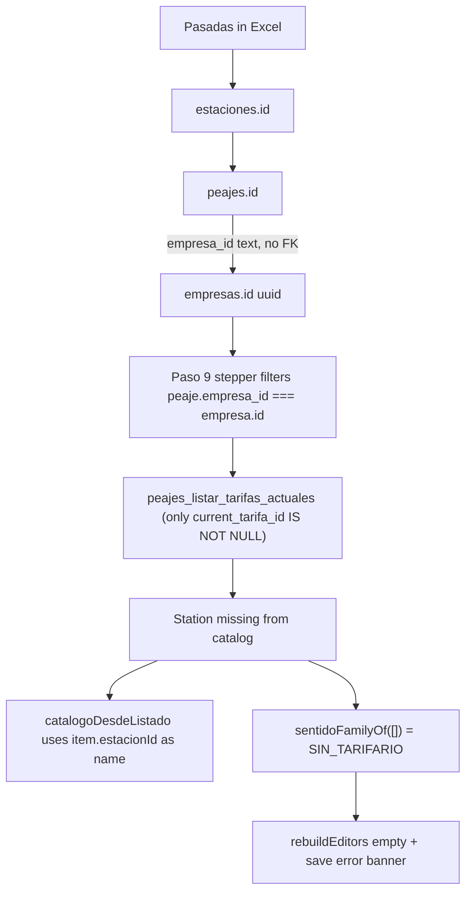

# Paso 9 empty tarifario + peaje–empresa FK

> **For agentic workers:** REQUIRED SUB-SKILL: Use superpowers:subagent-driven-development (recommended) or superpowers:executing-plans to implement this plan task-by-task.

**Goal:** In masivo Paso 9, a station without tarifario can create one in the same dialog; chips show station names; `peajes.empresa_id` is a real FK so pasadas match the document company and its tarifa.

**Architecture:** Keep `peajes_guardar_refresco_tarifas` (it already `INSERT`s new `tarifas` identities). The block is UI: `family === 'SIN_TARIFARIO'` skips editors and refuses save. Promote that family after the operator picks IDA/VUELTA/AMBAS and reuse the existing boards. Fix names by resolving `estaciones.nombre` instead of falling back to the UUID. Convert only `peajes.empresa_id` to `uuid` + FK; plantillas/documentos stay `text` + `'__global__'`.

**Tech Stack:** Angular 19 dialog + helpers, Supabase CLI migrations, pgTAP, Karma.

## Global Constraints

- CLI local is the test target; DESARROLLO push only with explicit user OK (`backend-supabase-write`).
- `npx supabase migration new` for timestamps; never invent them.
- No `/ 1.21`; no new public RPC unless a test proves `CONFIRM_NEW` cannot create identities.
- UI copy in Spanish; do not restyle the Tarifario boards.
- `'__global__'` remains valid on plantillas/algoritmos/documentos. On **peajes only**, `'__global__'` and empty text become `NULL` (visible to every empresa).

## Root causes (already traced)




Screenshot matches this path: chip `58a63fc1-…`, banner *No hay un tarifario cargado…*, stepper VIAL 8 S.A / Rutas Sur / Corredores / Corredor Vial 5 / Conexión Alto Delta.

Code:

- Name fallback: `[tarifa-refresh-dialog.component.ts](ibarra-app/src/app/components/peajes/wizard/paso9-revision/tarifa-refresh-dialog.component.ts)` `catalogoDesdeListado` sets `estacionNombre: item.estacionId` when the station is not in the tarifario listado.
- Hard block: same file `rebuildEditors` + `collectSaveDecisions` on `SIN_TARIFARIO`; template banner in `[tarifa-refresh-dialog.component.html](ibarra-app/src/app/components/peajes/wizard/paso9-revision/tarifa-refresh-dialog.component.html)`.
- Family: `[sentidoFamilyOf([])](ibarra-app/src/app/components/peajes/wizard/paso9-revision/tarifa-refresh-dialog.helpers.ts)` → `SIN_TARIFARIO`.
- Masivo filter: `[filtrarPorEmpresaActiva](ibarra-app/src/app/components/peajes/wizard/paso9-revision/paso9-revision.component.ts)` uses `peaje.empresa_id === activa.id`.
- Schema: `[peajes.empresa_id text](ibarra-app/supabase/migrations/20260730125513_peajes_catalogos.sql)` vs `[empresas.id uuid](ibarra-app/supabase/migrations/20260731124502_peajes_empresas.sql)`. Views join `emp.id::text = pj.empresa_id`.
- Save path already creates identities: `[20260914150417_peajes_refresh_no_coincide_multi_importe.sql](ibarra-app/supabase/migrations/20260914150417_peajes_refresh_no_coincide_multi_importe.sql)` `INSERT INTO public.tarifas` when `v_tarifa_id IS NULL`.

`202609-2.xlsx` is not in the repo; during verification search local Telepase folders / Downloads and run carga masiva against CLI seed.

## Task 1: Names — never show UUID chips

**Files:** `[tarifa-refresh-dialog.helpers.ts](ibarra-app/src/app/components/peajes/wizard/paso9-revision/tarifa-refresh-dialog.helpers.ts)`, `[tarifa-refresh-dialog.component.ts](ibarra-app/src/app/components/peajes/wizard/paso9-revision/tarifa-refresh-dialog.component.ts)`, `[paso9-revision.component.ts](ibarra-app/src/app/components/peajes/wizard/paso9-revision/paso9-revision.component.ts)` / `.html`, specs.

- Pass `estacionesCatalogo` (already loaded in Paso 9) into the dialog.
- Resolve name as `catalogo.nombre` → `candidato.estacionNombre` → never the raw UUID (fallback `'Estación'` only if both missing).
- Apply the same resolver in `catalogoDesdeListado`, `buildDetectedStations`, and checkbox `label`.
- Failing test: unresolved station absent from `peajes_listar_tarifas_actuales` still renders the catalog name on the chip and accordion header.

## Task 2: Create tarifario in-dialog for `SIN_TARIFARIO`

**Files:** dialog component/html/helpers + `[tarifa-refresh-dialog.component.spec.ts](ibarra-app/src/app/components/peajes/wizard/paso9-revision/tarifa-refresh-dialog.component.spec.ts)`, `[tarifa-refresh-dialog.helpers.spec.ts](ibarra-app/src/app/components/peajes/wizard/paso9-revision/tarifa-refresh-dialog.helpers.spec.ts)`.

Replace the blocking banner with a group-level `app-search-select` (existing Sentido control): IDA / VUELTA / AMBAS. Tables stay the current `app-tarifario-editor-board`.

After pick:

- `AMBAS` → promote `grupo.family` to `AMBAS`, rebuild editors (one board).
- `IDA` or `VUELTA` → promote to `DIRECCIONAL`, rebuild with both IDA and VUELTA boards (same as today’s directional editors).
- Keep **Vigente desde**; **Guardar cambios** uses existing `CONFIRM_NEW` (empty Nuevo still needs Pico/No pico + date as today).
- Do not persist identities on the select — only on save.
- Remove the save short-circuit that returns `[]` for `SIN_TARIFARIO`. Until sentido is chosen, disable Guardar with a short Spanish hint, not the current hard error.

Copy: *Elegí IDA, VUELTA o AMBAS para crear el tarifario de esta estación.*

## Task 3: `peajes.empresa_id` uuid FK (CLI migration)

**Files:** new migration via `npx supabase migration new peajes_empresa_id_fk` under `[ibarra-app/supabase/migrations/](ibarra-app/supabase/migrations/)`, pgTAP, seeds, views/RPCs that join peajes→empresas.

Per `[schema-foreign-key-indexes](ibarra-app/.agents/skills/supabase-postgres-best-practices/references/schema-foreign-key-indexes.md)` + `[schema-constraints](ibarra-app/.agents/skills/supabase-postgres-best-practices/references/schema-constraints.md)`:

1. `UPDATE peajes SET empresa_id = NULL WHERE empresa_id IN ('__global__', '') OR empresa_id IS NULL`.
2. Null out values that are not valid UUIDs or that do not exist in `empresas`.
3. `ALTER COLUMN empresa_id TYPE uuid USING empresa_id::uuid`.
4. `ALTER TABLE peajes ADD CONSTRAINT peajes_empresa_id_fkey FOREIGN KEY (empresa_id) REFERENCES empresas(id) ON DELETE RESTRICT` (idempotent `DO $$` block). Keep `idx_peajes_empresa_id`.
5. Recreate affected views/functions so joins use `emp.id = pj.empresa_id` instead of `emp.id::text = pj.empresa_id`. Keep PWBI/`peajes_auditoria_estaciones_universo` **output** as `text` via `pj.empresa_id::text` so signatures stay stable.
6. Update `[seed_peajes_f14.sql](ibarra-app/supabase/seed_peajes_f14.sql)` (`'__global__'` on the CLI audit peaje → `NULL`).
7. pgTAP: insert with unknown uuid fails; valid uuid succeeds; `'__global__'` insert fails; join returns `empresas.nombre`.

Do **not** change `documentos.empresa_id`, `plantillas_configuracion.empresa_id`, or `algoritmos_combinados.empresa_id`.

## Task 4: Masivo matching uses the FK

**Files:** `[tarifario-por-empresa.ts](ibarra-app/src/app/components/peajes/wizard/paso9-revision/tarifario-por-empresa.ts)`, `[paso9-revision.component.ts](ibarra-app/src/app/components/peajes/wizard/paso9-revision/paso9-revision.component.ts)` `filtrarPorEmpresaActiva`, `[paso6-estaciones.component.ts](ibarra-app/src/app/components/peajes/wizard/paso6-estaciones/paso6-estaciones.component.ts)`, `[paso7-factura.component.ts](ibarra-app/src/app/components/peajes/wizard/paso7-factura.component.ts)`, `[consumos-resumen.helpers.ts](ibarra-app/src/app/components/peajes/models/consumos-resumen.helpers.ts)`.

Treat `peaje.empresa_id == null` as the old `'__global__'` (visible in every empresa stepper/pool). Keep strict equality for assigned peajes so VIAL 8 pasadas only open VIAL 8’s tarifario.

Chain to preserve: Excel pasada → `estacion_id` → `peajes.empresa_id` → document `empresa_id` → refresh candidates for that stepper.

## Task 5: Docs + verification

**Docs:** `[refresh-tarifas-paso9.md](ibarra-app/docs/backend/peajes/refresh-tarifas-paso9.md)`, `[wizard.md](ibarra-app/docs/06-components/peajes/wizard.md)` Paso 9, `[catalogos.md](ibarra-app/docs/06-tablas/peajes/catalogos.md)`, `[functions/index.md](ibarra-app/docs/backend/functions/index.md)` only if a new RPC appears (expected: no), `[claude-progress.md](ibarra-app/docs/claude-progress.md)`, `feature_list.json` (F14-21 follow-up evidence).

**Verify (from `ibarra-app`):**

```powershell
npx supabase db reset --local --no-seed
npx supabase test db
pnpm seed:local
pnpm exec ng test --watch=false --browsers=ChromeHeadless `
  --include="**/tarifa-refresh-dialog.helpers.spec.ts" `
  --include="**/tarifa-refresh-dialog.component.spec.ts" `
  --include="**/paso9-revision/**/*.spec.ts" `
  --include="**/tarifario-por-empresa.spec.ts"
npx tsc --noEmit -p tsconfig.app.json
npx tsc --noEmit -p tsconfig.spec.json
```

Browser: carga masiva with `202609-2.xlsx` (or the local Telepase September file), documents for the five companies in the screenshot, open Tarifario on a newly created peaje with no prices — choose sentido, see named station + boards, save, revalidate match against that empresa’s tarifa. Do not `db push --linked` unless asked.
